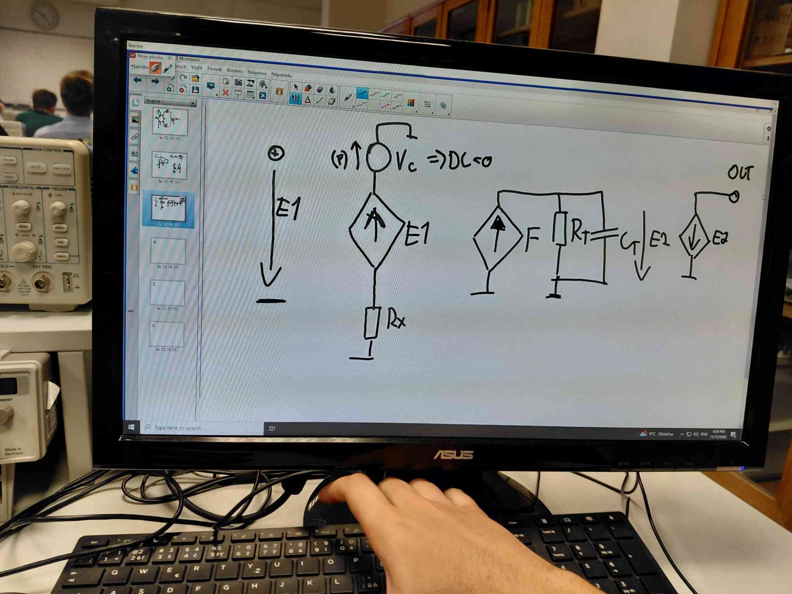

# Zkouška: základní model transimpedančního zesilovače (CFA, AD844)

> [!important] Bude u zkoušky
> Náhlík říká, že **u zkoušky bude chtít základní model transimpedančního zesilovače** (zesilovač s proudovou zpětnou vazbou, CFA, např. AD844) a **frekvenční vztah** pro mezní kmitočet.

## Model

| Prvek | Funkce |
|---|---|
| **E1** | napěťový sledovač (zisk 1): napětí na vstupu +IN se přenese na invertující vstup X |
| **Vc** | zdroj 0 V v sérii s výstupem E1 (DC = 0), jen **snímá proud** $I_X$ vstupem X |
| **Rx** | vstupní odpor invertujícího vstupu X (u AD844 řádově desítky Ω) |
| **F** | proudem řízený zdroj proudu (CCCS), kopíruje $I_X$ do uzlu Z (TZ) |
| **Rt ‖ Ct** | transimpedance v uzlu Z – $R_T$ (jednotky MΩ) a $C_T$ (jednotky pF) |
| **E2** | výstupní napěťový sledovač Z → OUT |

Přenos: $V_Z = I_X \cdot Z_T$, kde $Z_T = R_T \parallel \frac{1}{j\omega C_T}$ → „transimpedanční“ zesilovač.

## Frekvenční vztah (neinvertující zapojení)

Zpětná vazba: R2 z OUT do X, R1 z X na zem, zesílení $G = 1 + \frac{R_2}{R_1}$.

$$
\omega_c = \frac{1}{(R_2 + G\,R_x)\,C_T}
\qquad\Rightarrow\qquad
f_c = \frac{1}{2\pi\,(R_2 + G\,R_x)\,C_T}
$$

- Šířku pásma určuje hlavně **R2**, ne zesílení G → u CFA lze měnit zisk pomocí R1 bez ztráty šířky pásma.
- Pro $R_x \to 0$: $f_c = \frac{1}{2\pi R_2 C_T}$.
- Při malém R2 začne převažovat člen $G\,R_x$ a šířka pásma klesá.

## Ověření simulací (LTspice, $R_T$ = 4 MΩ, $C_T$ = 5 pF, G = 10)

| R2 / R1 | fc (Rx = 0) | fc (Rx = 50 Ω) |
|---|---|---|
| 45k / 5k | 715 kHz | 708 kHz |
| 450 / 50 | 70,7 MHz | 33,5 MHz |

Pro srovnání makromodel AD844: 656 kHz a 44,7 MHz.
