# EPL – otázky 1–50 (převzato z Anki)

## Otázka 1. až 4. :
1. Zobrazte krystalografické roviny určené Millerovými indexy (100) a (311)
2. Zobrazte krystalografické roviny určené Millerovými indexy (111) a (210)
3. Zobrazte krystalografické roviny určené Millerovými indexy (100) a (221)
4. Zobrazte krystalografické roviny určené Millerovými indexy (110) a (121)

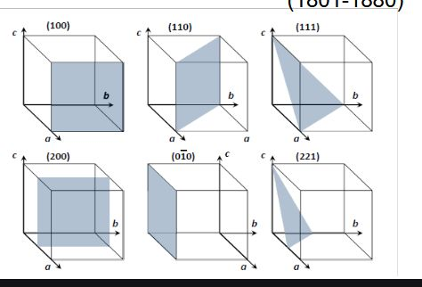

platí h:k:l = 1/a 1/b 1/c

## Otázka 5: Vyjmenujte a popište operace symetrie v krystalech

inverze: symetrie přes bod
reflexe: symetrie přes rovinu
rotace: symetrie přes rotační osu

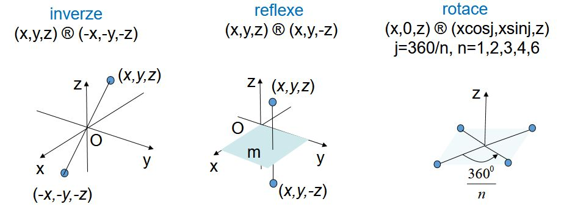

## otázka 6: Vyberte jednu z krystalových soustav a popište její vlastnosti

Pokud máš rád svuj čas a život tak vyber kubickou a věz že je to prostě spíčená kostka.

Pro fajnšmekry:
triklinická:

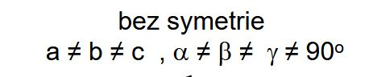

monoklinická:

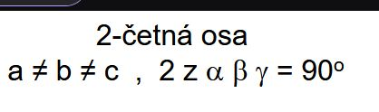

ortorombická:

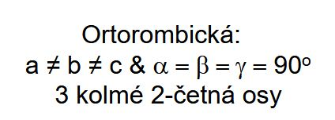

**Kubická:**

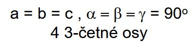

Tetragonální:

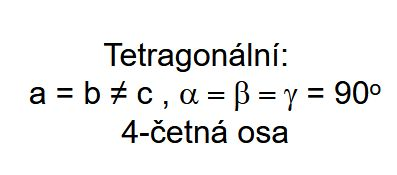

Trigonální:

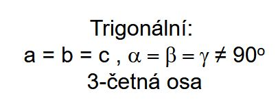

Hexagonální:

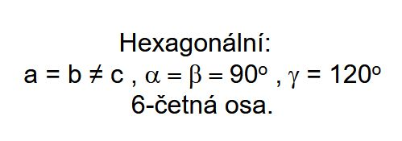

## Otázka 7: Jaká jsou možná nejtěsnější uspořádání atomů v mřížce

Hexagonální ABABAB

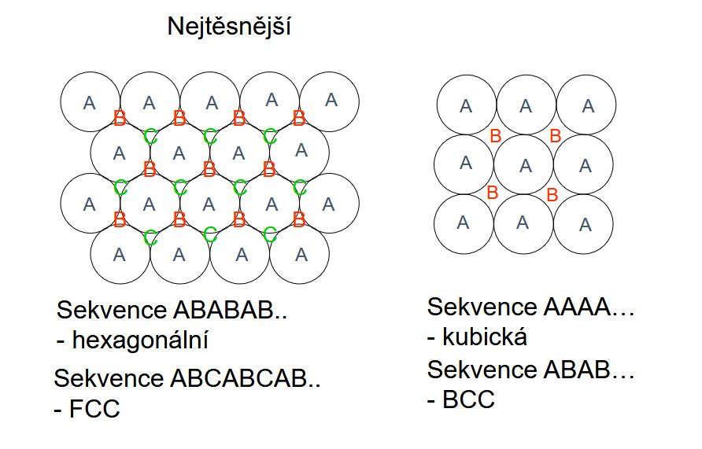

## Otázka 8: Nakreslete základní buňku kubické, prostorově centrované mřížky

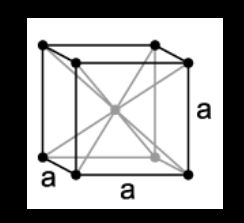

## otázka 9: Nakreslete základní buňku kubické, plošně centrované mřížky

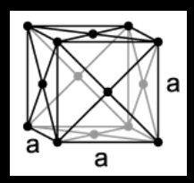

## Otázka 10: Co to je Wignerova-Seitzova buňka, nakreslete ji pro 2D mřížku

Wignerova-Seitzova buňka je množina bodů, které jsou k bodu mřížky blíže, než ke kterémukoliv jinému bodu mřížky:

Konstrukce:

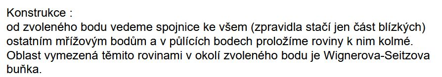

Ve 2D:

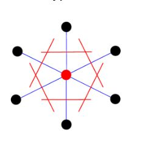

## Otázka 11. : Jak vznikne sfaleritová mřížka, nakreslete jeden atom v této mřížce s jeho nejbližšími sousedy

Kubická mřížka, každá FCC jiný atom:

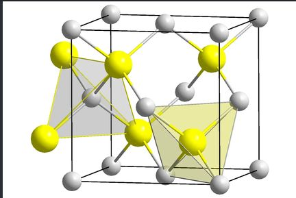

## Otázka 12: Jak vznikne diamantová mřížka, nakreslete jeden atom v této mřížce s jeho nejbližšími
sousedy

A.k.a křemíková mřížka, dvě krychle v sobě, dělá to pak takový šestiúhelníky:

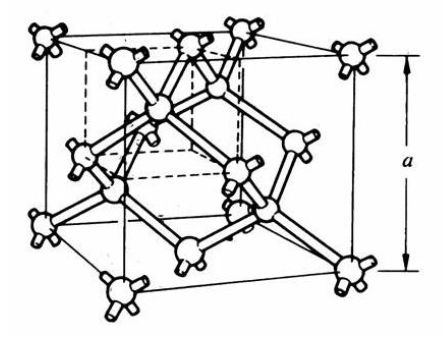

## Otázka 13: Co to jsou akustické fonony, nakreslete závislost E(q) pro akustickou větev

Kvanta kmitů v krystalové mřížce: pohybují se ve stejném směru a fázi

Nakreslit chce asi tenhle obrázek?:

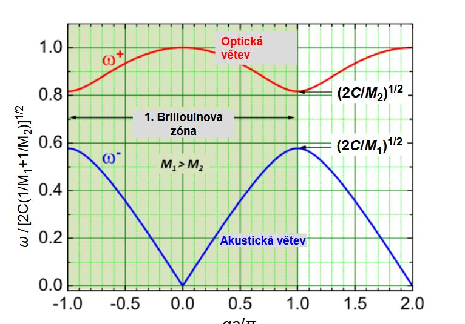

## Otázka 14: Co to jsou optické fonony, nakreslete závislost E(q) pro optickou větev

Kvanta kmitů v krystalické mřížce pohybující se proti sobě v protifázi

Obrázek:

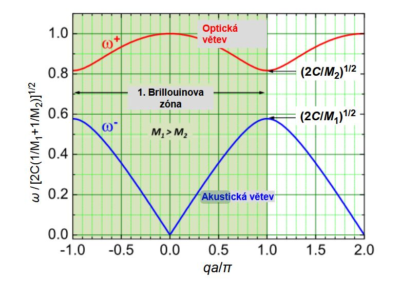

## Otázka 15: Porovnejte Einsteinovu a Debyeovu aproximaci měrného tepla krystalu

Einsteinova aproximace:
Kmitající krystal nahrazuje souborem 3Ns stejných oscilátoru
s frekvencí ωE , tj. ideálním plynem fononů s energií ℏωE

Použití: hodí se pro úzké optické pásy

Debeyova aproximace:
Předpokládejme jedno jádro v elementární buňce (s=1) a
uvažuje izotropní elastické kontinuum s disperzní závislostí

ω = v*q

kde v je rychlost zvuku

Použití: Hodí se na akustické větve

## Otázka 16: S jakými jevy souvisí teplotní roztažnost krystalů

S anharmonickými jevy a anharmonickým kmitánímm střední vzdálenost se totiž lineárně zvyšuje s teplotou. Musíme upravit aproximaci kmitání

## Otázka 17. : Napište Gibsův fázový zákon, co vyjadřuje

Gibbsův fázový zákon:

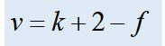

v = počet nezávisle proměnných
k = počet složek soustavy
f = počet koexistujících fází
Popisuje kolik skupenských fází může mít daná soustava

## Otázka 18. : Nakreslete p,T diagram jednosložkové soustavy, označte plochy a významné body

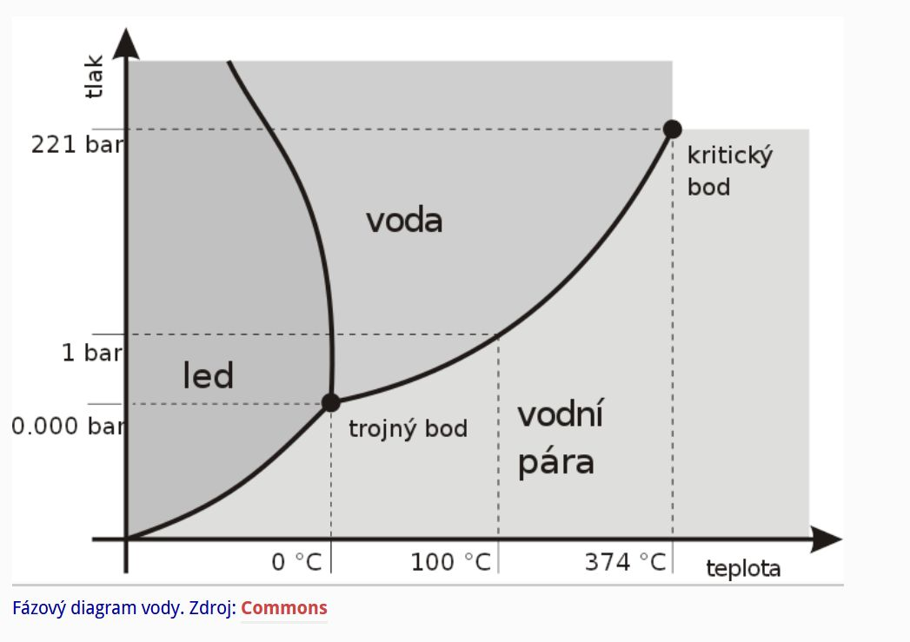

## Otázka 19. : Nakreslete x,T diagram dvousložkové soustavy úplně mísitelné v kapalném i tuhém
stavu, označte plochy

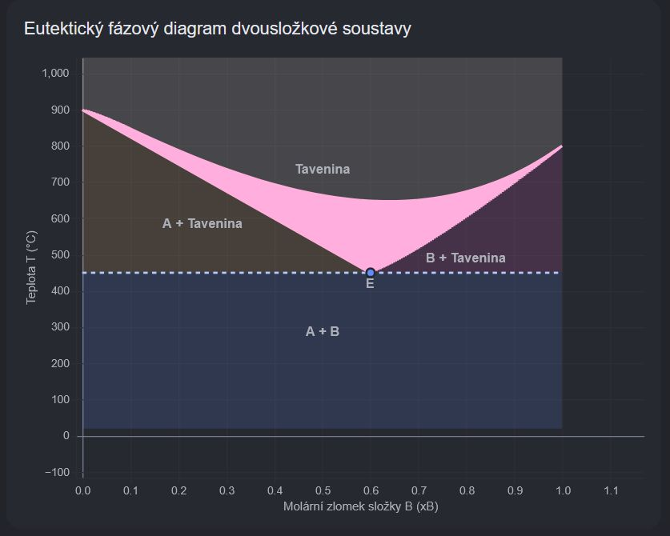

## Otázka 20. : Co je to kongruentní krystalizace

Proces, při kterém se **kapalná fáze (tavenina) přeměňuje na pevnou fázi (krystal) o naprosto stejném chemickém složení**, a to bez jakýchkoliv mezikroků nebo vzniku jiných fází. (Gemini)

## Otázka 21.: Nakreslete x,T diagram dvousložkové eutektické slitiny omezeně mísitelné v tuhém
stavu, označte plochy

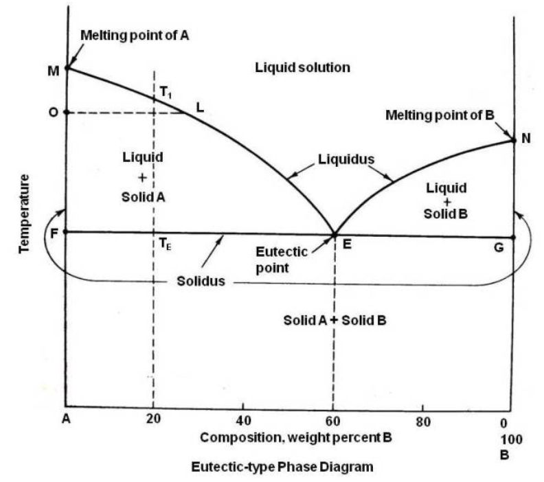

## Otázka 22. : Jaké jsou podmínky vzniku substitučního tuhého roztoku

Atomy příměsy nahrazují původní atomy v krystalové mřížce, může být uspořádaný a nebo taky ne.

## Otázka 23. : Vysvětlete metodu zonálního čištění krystalu

Nečistoty se drží v kapalině

Vezme se křemíkový ingot a na jednom konci okolo něj přiloží cívka(co ho indukcí lokálně roztaví) cívka se velmi pomalu pohybuje podél ingotu. S cívkou se táhne i roztavená zóna v ingotu, která “sbírá” všechny nečistoty

## Otázka 24. : Nakreslete jednotlivé typy bodový poruch v krystalu

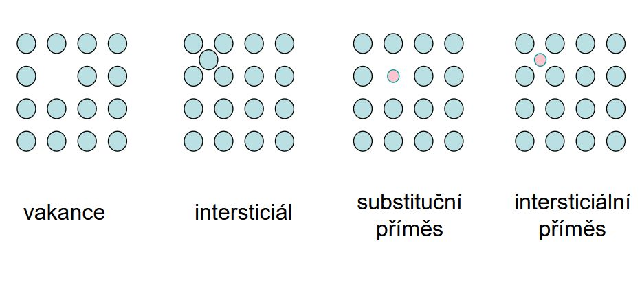

## Otázka 25: Jaká je závislost koncentrace vakancí na teplotě

Roste exponencionálně s teplotou:
Cv = exp [- Ef / kT]

## Otázka 26: Co je to Schottkyho a Frenkelova porucha

Freknelova porucha: pár kationtové vakance a intersticiálu
Shottkyho porucha: pár kationtové a aniontové vakance

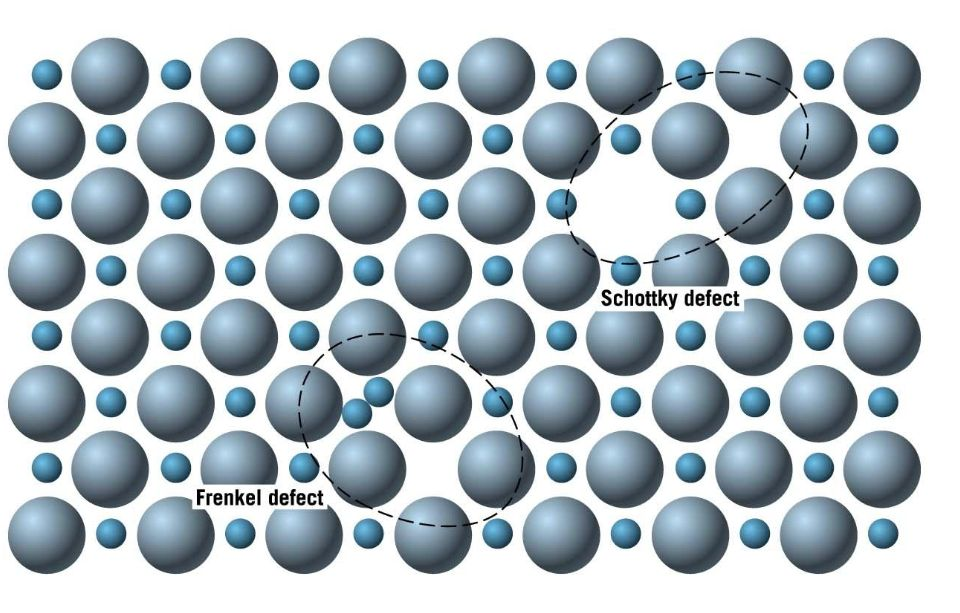

## Otázka 27: Jak se liší Burgersův vektor hranové a šroubové dislokace

Je-li Burgesův vektor kolmý na hranu zkluzu hovoříme o hranové dislokaci

Je- li burgesův vektor rovnoběžný s hranou skluzu hovoříme o šroubové dislokaci

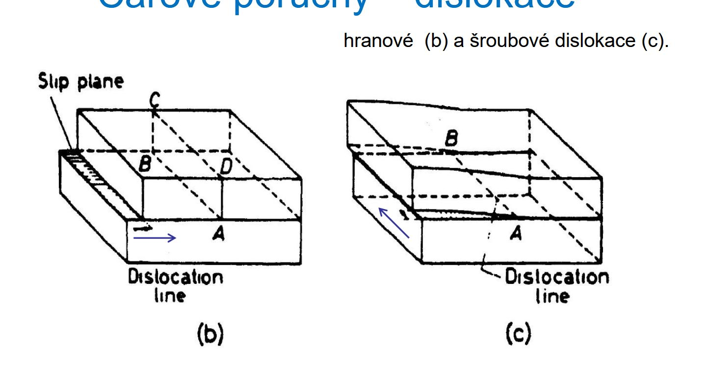

## Otázka 28. : Popište mechanismus skluzu a mechanismus šplhání dislokací

Šplhání dislokací: dochází k anihilací vakancí, což pak vede ke šplhání dislokací:

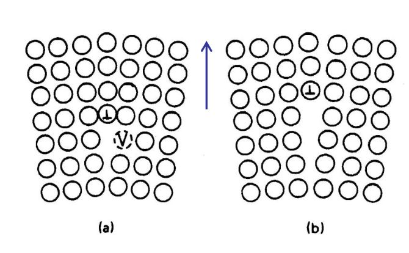

Skluz: v rámci dislokační linie dochází k psouvu krystalické mřížky a následnému skluzu

## Otázka 29. : Popište maticovou notaci rekonstruovaného povrchu krystalu

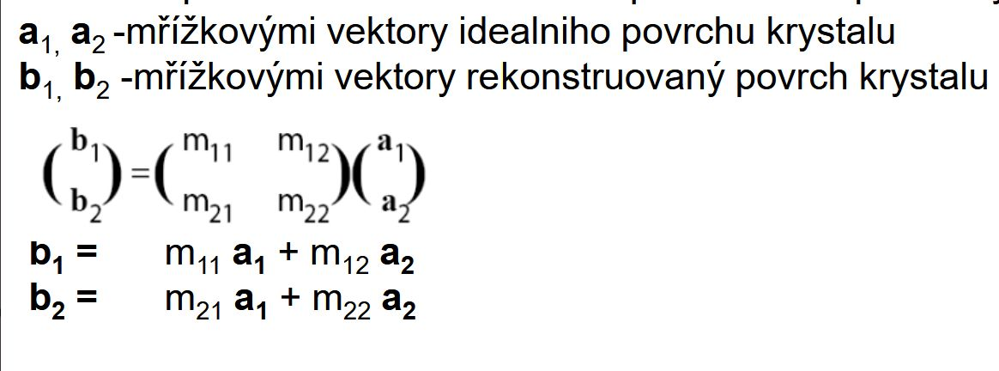

matice M je transformační matice krystalu

## Otázka 30. : Uveďte definici vektoru reciproké mřížky

vektor reciproké mřížky V = (a*, b*, c*)

a* = (b x c)/V
b* = (c x a)/V
c* = (axb)/V

kde V je objem elementární buňky a vektor (a,b,c) je vektor přímé mřížky

## Otázka 31. : Nakreslete a popište odvození Braggovy difrakční rovnice

nλ = 2d*sin(**θ**)

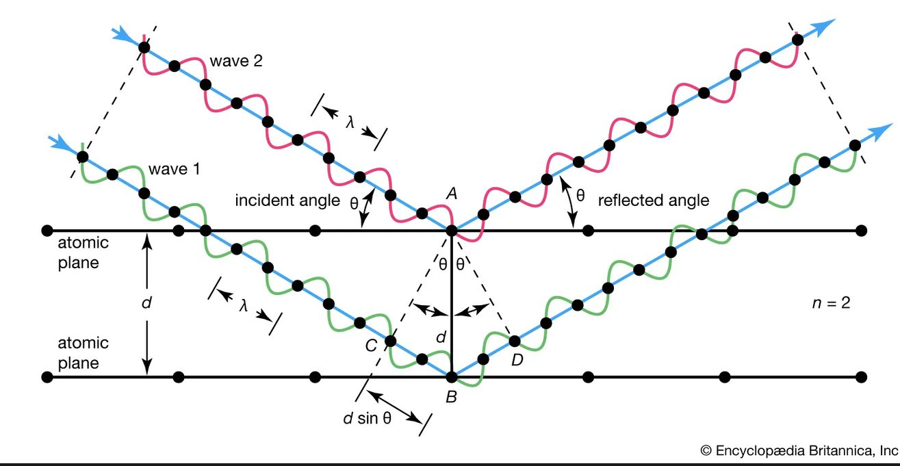

## Otázka 32. : Popište metodu Evaldovy konstrukce #TODO

Jedná se o geometrické vyjádření Breggova zákona,

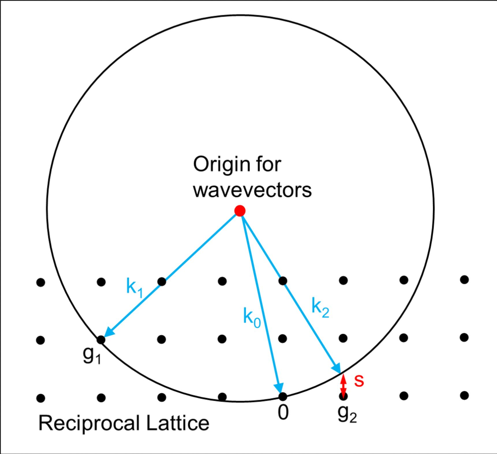

## Otázka 33. :  Vyjmenujte a charakterizujte jednotlivé roentgenové difrakční metody

Laueho metoda - jako zdroj celé spektrum, krystal odráží jednotlivé vlnové délky, ty se pak zachycují na film. Metoda slouží primárně k určení symetrie a orientace krystalu. Je rychlá nemusí být přesná.

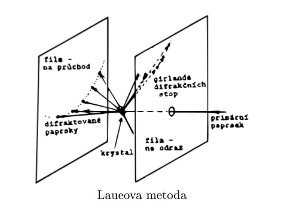

Metoda rotujícího krystalu - monochromatické záření dopadá na rotující krystal, který je obklopený záchytným filmem. Jednotlivé roviny postupně splňují Braggovu podmínku a odrážejí záření.

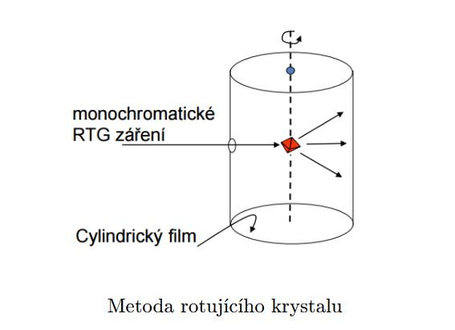

Wiesenbergova metoda - slouží k zobrazení reciprocké mříže. Rotující krystal obklopený válcem s tenkou škvírkou, za kterou se nahoru a dolů posouvá film.

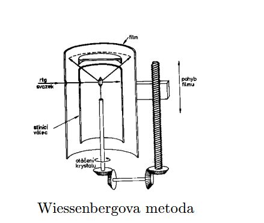

Prášková metoda - POLYkrystal je nanesen na tyčku která se otáčí, tyčka je obklopena filmem, ve kterém je tenká zdířka, kterou prochází monochromatické rentgenové záření. Metoda slouží k analýze meziatomových rovin a celkové struktury polykrystalu.

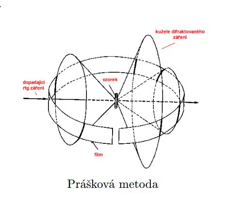

## Otázka 34. : Jak se v difrakčním obraze projeví tzv. strukturní factor

Strukturní faktor udává intenzitu krystalem rozptýleného světla. Jedná se o součet amplitud vln rozptýlenými jedntolivými atomy v mřížce.

## Otázka 35. : Jakou energii by měli mít elektrony pro difrakční analýzu krystalu, proč

EK = 40 eV Vychází to z hybnosti elektronů a vhodné vlnové délce elektronů.

## Otázka 36. : Co to je Brillouinova zóna, jak vznikne, proč se zavádí?

Jedná se o primitivní buňku  v reciprocké mřížce (obdoba Wigner-Seitzovy mřížky). Tato mřížka se pak v materiálu periodicky opakuje, vyzkoumáme-li tedy vlastnosti pouze v této buňce známe je v celém materiálu.

## Otázka 37. : Co je to Madelungova konstanta?

Určuje uspořádání struktury kationtů a aniontů při výpočtu napětí za pomoci Coloumbova zákona.:

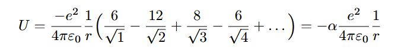

v tomto vzorečku je Madelungova konstanta α

## Otázka 38. : Charakterizujte σ vazbu a π vazbu

σ vazba: Maximální hustota elektronů na spojnici atomových jader. Stabilní a silná vazba.
π vazba: Maximální hustota elektronů mimo spojnici atomových jader. Slabší kovalntní vazba, která vzniká společně se σ vazbami

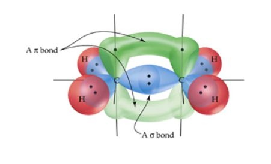

## Otázka 39. : Jaký je vztah mezi elektronegativitou a iontovou vazbou?

Podle elektronegativity rozlišujeme vazby na:
nepolární -> elektronegativita nížší než 0,4 společně zdílená dvojce elektronů je přibližně uprostřed
polární -> elektronegativita mezi 0,4 a 1,7 společná dvojce elektronů je vychýlena
iontová -> exktrémní verze polární vazby, elektronegativita větší než 1,7. vzniká Kationt a Aniont

## Otázka 40. : Charakterizujte vlastnosti krystalů podle toho, jaké vazby se v nich
vyskytují.

Iontové krystaly : Křehké, Tvrdé, vysoký bod tání, nevedou el. proud a jsou průhledné v širokém spektru (příklad: NaCl)Kovové krystaly: Kujné, měkčí, dobrá tepelná a el. vodivost (příklad: ocel)Kovalentní materiály: Vysoká tvrdost a křehkost, vysoký bod tání, nízká el. vodivost příklad: (diamant)

## Otázka 41. : Co je hybridizace orbitalů, uveďte příklady

Dojde k mixování orbitalů na jedné energetické úrovni vznikají tak sp orbitaly. Hybridní orbitaly vznikají když se elektrony z různmých orbitalů dostanou na stejnou ůroveň.

Typy hybridizace:
sp3: (a.k.a 3D struktura)

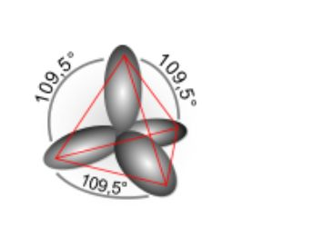

sp2: (a.k.a 2d struktura)

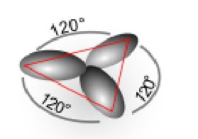

sp1: (a.k.a 1d struktura)

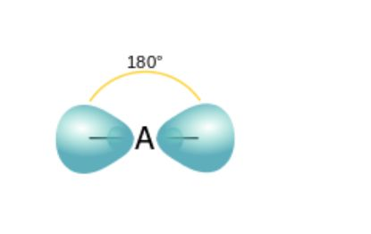

## Otázka 42. : Jaké typy vazeb se vyskytují v krystalu GaAs

Má mix iontovo-kovalentních vazeb.

## Otázka 43. : Jaké typy vazeb se vyskytují v krystalu Si?

Čistě kovalentní vazby.

## Otázka 44. : Jak vzniká Van der Waalsova vazba?

Interakcí mezi elektrickými dipóly a nerovnoměrnou distribucí elektronů kolem jádra.

## Otázka 45. : Nakreslete průběh hustoty stavů v objemovém polovodiči, co vyja-
dřuje hustota stavů?

Obrázek:

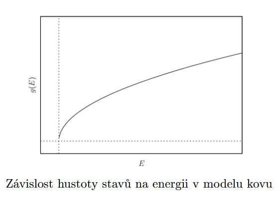

Hustota stavů je počet dovolených stavů na jednotkový objem energie

## Otázka 46. : Vysvětlete princip vzniku Blochových oscilací.

Blochova oscilace je jev kdy částice zachycena v poli s periodickým potenciálem a na dnaou částici působí konstantní síla, tak bude pohyb částice periodický.

Vezmeme-li tedy ideální krystal a dáme ho do konstantního elektrického pole, tak elektrony v něm budou kmitat.

## Otázka 47. : Co je to Blochova funkce, z čeho vyplývá?

Libovolná fce, která je řešením Schrodingerovy rovnice s periodickým potencionálem má vektor **k** takový že při translaci o vektor **a **se u funkce **ψ **mění pouze fáze a to o faktor e^(j**ka**). **ψ **je pak *Blochovou funkcí. *

## 48. : Co je to Kronig-Penneyho model polovodiče?

Aproximuje potenciál schodovou funkcí.
Řešení Shrodingerovy rce s tímto modelem potenciální energie dává přípustné hodnoty energie elektronů rozdělené do pásů oddělených od sebe tzv. zakázaným pásem

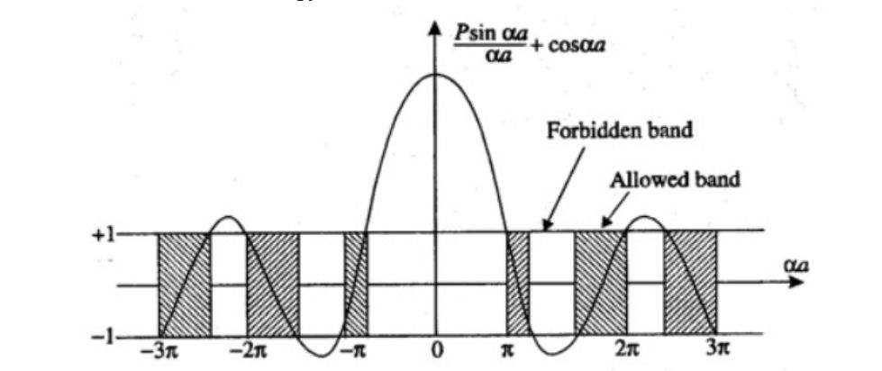

## 49. : Popište vliv tlaku na pásovou strukturu polovodičů.

Zvyšování tlaku -> rozšiřování zakázaného pásu

## 50. : Popište vliv teploty na pásovou strukturu polovodičů.

Se zvyšující se teplotou se zmenšuje zakázaný pás a polovodiče lépe vedou proud.
